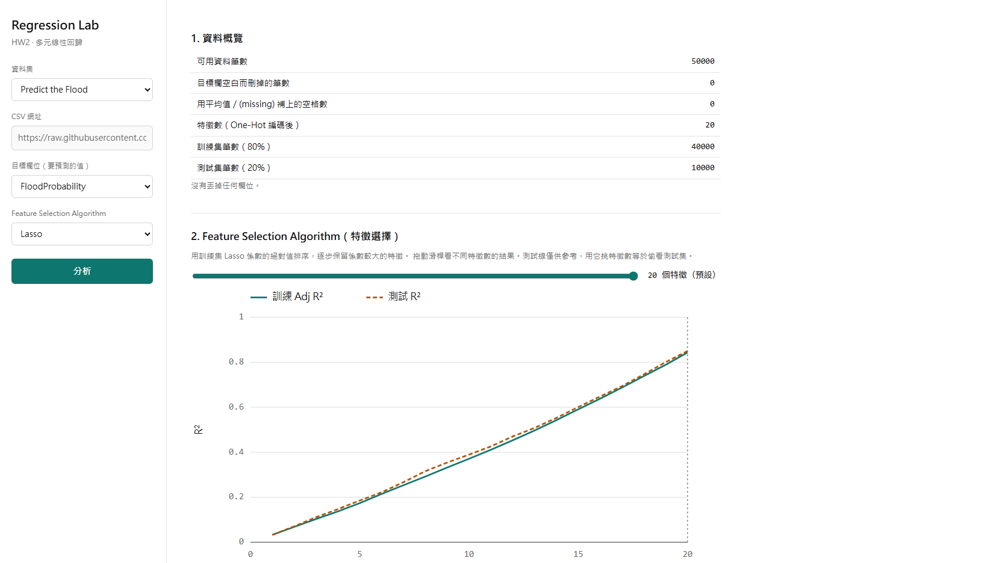

# HW2 多元線性回歸（Regression Lab）

線上網址：<https://ryanyeh57.github.io/HW2-multiple-linear-regression/>



## 功能

- 下拉選單切換兩個題目：**Predict the Flood**、**50 Startups**。
- **自訂網址**：貼任何 CSV 網址，馬上分析。
- 多元線性回歸（OLS），顯示係數、標準誤、p 值。
- Feature Selection Algorithm：Backward Elimination、Forward Selection、SelectKBest、RFE、Lasso。滑桿可切換特徵數。
- Comparison of Regression Models：Linear Regression、Ridge（lambda = 1）、Lasso（lambda = 0.01）。
- 模型評估（測試集）：R²、Adjusted R²、MAE、RMSE。
- 預測圖含 **95% 預測區間**，另有殘差圖。

## 分析流程

1. 讀 CSV，第一列當欄位名。
2. 刪掉目標欄空白的列；數字缺值用訓練集平均補上；文字欄做 One-Hot（丟掉第一個類別）。
3. 丟掉所有值都一樣的欄位，和不同值超過 20 個的文字欄（像 ID）。
4. 80% 訓練、20% 測試，亂數種子 42。
5. 只用訓練集做特徵選擇和擬合；指標在測試集計算。測試線只供參考，不用來挑方法或特徵數。
6. 預測圖沿用 OLS，顯示 95% 預測區間；Ridge 和 Lasso 用於模型比較。

## CRISP-DM 流程

| 階段 | 這個專案做了什麼 | 網頁位置 |
|---|---|---|
| Business Understanding | 預測一個連續數值：Flood 預測洪水機率 `FloodProbability`，50 Startups 預測公司利潤 `Profit`。自訂網址可選任一數字欄當目標。 | 左側「資料集」、「目標欄位」 |
| Data Understanding | 顯示可用筆數、缺值數、特徵數，以及被丟掉的欄位和原因。 | 1. 資料概覽 |
| Data Preparation | 刪掉目標欄空白的列；數字缺值補訓練集平均；文字欄 One-Hot；丟掉常數欄和類別太多的文字欄；80/20 切分（seed 42）。 | 1. 資料概覽 |
| Modeling | 五種特徵選擇（Backward、Forward、SelectKBest、RFE、Lasso），只用訓練集。比較 Linear Regression、Ridge（lambda = 1）、Lasso（lambda = 0.01）。 | 2. Feature Selection Algorithm、3. Comparison of Regression Models、7. 迴歸係數 |
| Evaluation | 在測試集算 R²、Adjusted R²、MAE、RMSE；畫含 95% 預測區間的預測圖和殘差圖。測試集不用來挑特徵或模型。 | 4. 模型評估、5. 預測圖、6. 殘差圖 |
| Deployment | 純靜態網站放在 GitHub Pages，所有計算在瀏覽器完成；可用 `?url=` 分享分析連結。 | 線上網址 |

## 資料來源

| 題目 | 來源 | 筆數 | 特徵 |
|---|---|---|---|
| Predict the Flood | Kaggle [playground-series-s4e5](https://www.kaggle.com/competitions/playground-series-s4e5/data) 的 `train.csv`，隨機抽 50,000 筆（seed 42），拿掉 `id` | 50,000 | 20 |
| 50 Startups | [Avik-Jain/100-Days-Of-ML-Code](https://raw.githubusercontent.com/Avik-Jain/100-Days-Of-ML-Code/master/datasets/50_Startups.csv) | 50 | 4 |

重新產生 `data/flood.csv`（原始檔不在 repo 裡，需要先從 Kaggle 下載 `train.csv` 放到 `data/raw/`）：

```bash
node scripts/sample-flood.js data/raw/train.csv data/flood.csv
```

## 分享連結

在網址後面加 `?url=<CSV 網址>`，打開就會直接分析：

```
https://ryanyeh57.github.io/HW2-multiple-linear-regression/?url=https://raw.githubusercontent.com/Avik-Jain/100-Days-Of-ML-Code/master/datasets/50_Startups.csv
```

## 本機執行

```bash
python -m http.server 8000
```

打開 <http://localhost:8000/>。（不能直接雙擊 `index.html`，因為瀏覽器不允許 `file://` 讀資料檔。）

## 測試

需要 Node.js 22 以上：

```bash
npm test
```

## 限制

- 自訂網址必須允許跨站讀取（CORS）。GitHub raw 可以；Kaggle 需要登入，讀不到。
- 只做線性回歸家族：OLS、Ridge、Lasso。目標欄必須是數字。
- 編碼後特徵最多 100 個。
